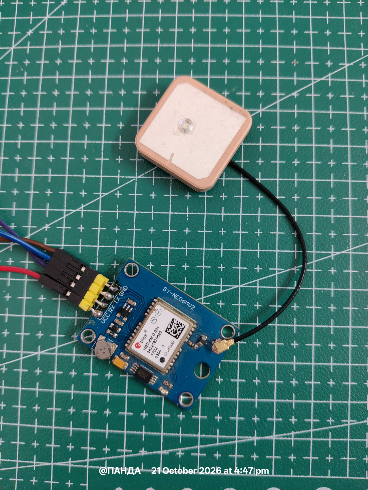
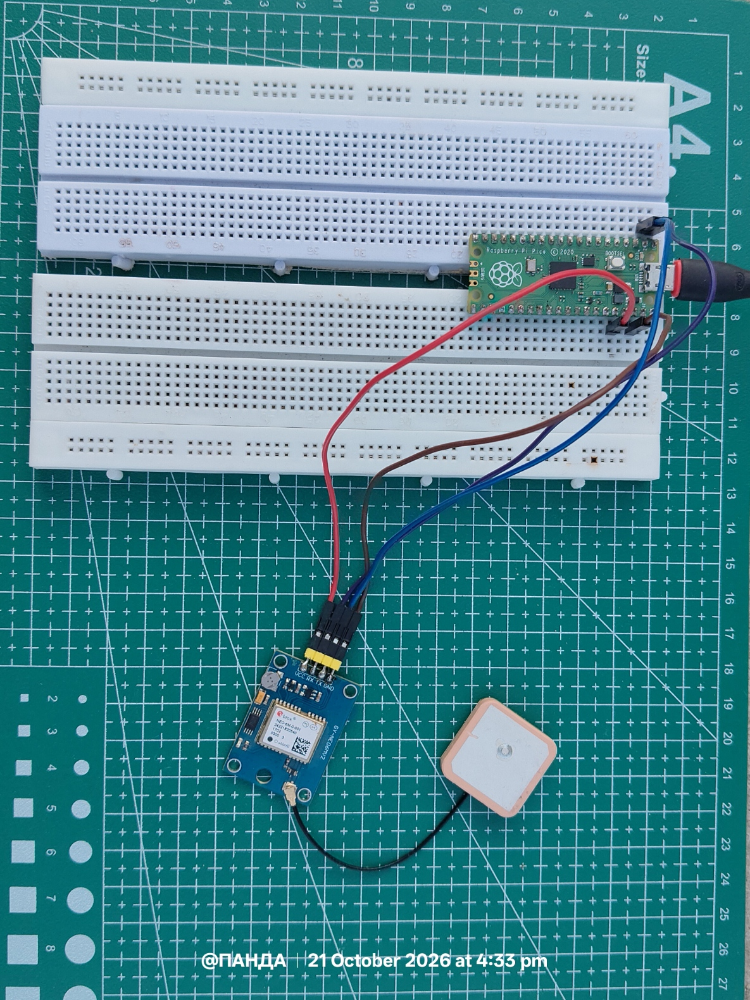
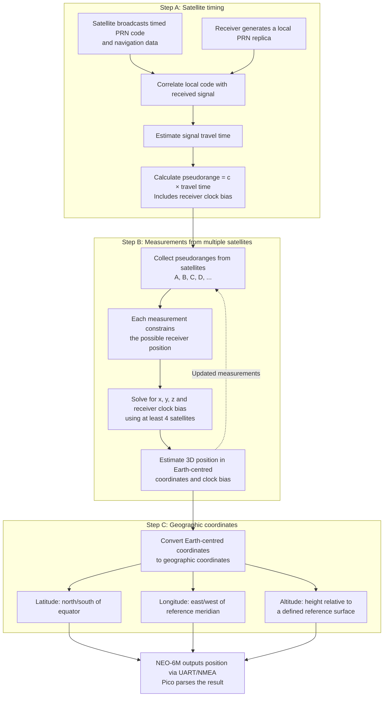

# NEO-6M GPS 

<p align="center">
 
</p>

## Interfacing NEO-6M GPS module with PICO via UART 



The NEO-6M is a radio navigation receiver which is able to listen to gps satellites which are orbiting the Earth without the need of a SIM Card or Wifi or any active internet connection to obtain the GPS fix. 

## Table of Contents

- [NEO-6M GPS](#neo-6m-gps)
- [Interfacing NEO-6M GPS Module with PICO via UART](#interfacing-neo-6m-gps-module-with-pico-via-uart)
- [Hardware Wiring Context](#hardware-wiring-context)
- [UART Communication Parameters](#uart-communication-parameters)
- [How It Actually Works?](#how-it-actually-works-)
- [Background: The NMEA GGA Sentence](#background-the-nmea-gga-sentence)
  - [Converting NMEA Coordinates to Decimal Degrees](#converting-nmea-coordinates-to-decimal-degrees)
- [Raw UART Test](#raw-uart-test)
- [Satellites in View vs. Satellites Used](#satellites-in-view-vs-satellites-used)
- [Line-by-Line Explanation](#line-by-line-explanation)
  - [Imports](#imports)
  - [UART Initialisation](#uart-initialisation)
  - [Startup Messages](#startup-messages)
  - [Main Loop and Reading a Line](#main-loop-and-reading-a-line)
  - [Decoding](#decoding)
  - [Filtering for GGA Sentences](#filtering-for-gga-sentences)
  - [Field Splitting and Validation](#field-splitting-and-validation)
  - [Extracting Fix Status and Satellite Count](#extracting-fix-status-and-satellite-count)
  - [Reporting a Fix](#reporting-a-fix)
  - [Reporting No Fix](#reporting-no-fix)
  - [Error Handling](#error-handling)
  - [Loop Pacing](#loop-pacing)
- [Output](#output)
- [Limitations and Possible Improvements](#limitations-and-possible-improvements)


## Hardware Wiring Context

| GPS module pin | Pico pin | Notes |
| --- | --- | --- |
| TX | GP1 (UART0 RX) | Module transmits, Pico receives |
| RX | GP0 (UART0 TX) | Optional here, since the program never writes to the module |
| VCC | 3V3 (or 5V if the module has a regulator) | Check your module's datasheet |
| GND | GND | Common ground is mandatory |

## UART Communication Parameters

| Parameter   | Value                     |
|-------------|---------------------------|
| Interface   | UART0                     |
| Baud rate   | 9600 bps                  |
| Data format | 8-N-1                     |
| Pico TX     | GP0                       |
| Pico RX     | GP1                       |
| Protocol    | NMEA 0183 ASCII sentences |

TX and RX cross over: Pico TX (GP0) connects to the NEO-6M RX pin, and Pico RX (GP1) connects to the NEO-6M TX pin.


## How it actually Works ? 




---

## Background: The NMEA GGA Sentence

A GPS module continuously emits ASCII lines called *sentences*. Each begins with `$`, a two-letter *talker ID*, a three-letter *sentence type*, comma-separated fields, and ends with `*` plus a two-digit checksum and a line terminator. Example:

```
$GPGGA,123519.00,4807.0380,N,01131.0000,E,1,08,0.9,545.4,M,46.9,M,,*47
```

Splitting this on commas gives the field list the program relies on:

| Index | Meaning | Example |
| --- | --- | --- |
| 0 | Sentence ID (talker + type) | `$GPGGA` |
| 1 | UTC time (hhmmss.ss) | `123519.00` |
| 2 | Latitude (ddmm.mmmm) | `4807.0380` |
| 3 | Latitude hemisphere (N/S) | `N` |
| 4 | Longitude (dddmm.mmmm) | `01131.0000` |
| 5 | Longitude hemisphere (E/W) | `E` |
| 6 | Fix quality (0 = no fix, 1 = GPS, 2 = DGPS, and so on) | `1` |
| 7 | Number of satellites used in the solution | `08` |
| 8 | HDOP (horizontal dilution of precision) | `0.9` |
| 9 | Altitude above mean sea level | `545.4` |
| 10 | Altitude units | `M` |
| 11 to 14 | Geoid separation, units, DGPS age and station ID plus checksum | |

The **talker ID** tells you which constellation produced the sentence. `GP` means GPS only. `GN` means a combined solution from multiple constellations (GPS, GLONASS, Galileo, BeiDou). Modern modules often emit `GN`, which is why the program checks for both.


### Converting NMEA coordinates to decimal degrees

NMEA GGA uses degrees and decimal minutes rather than decimal degrees.

For example:

$$
31^\circ 30.99828' = 31 + \frac{30.99828}{60}
= 31.516638^\circ
$$

Similarly:


$$76^\circ 52.91852' = 76 + \frac{52.91852}{60}
\approx 76.882^\circ$$


For south latitude or west longitude, the decimal-degree result should be negative. 


### Raw Uart Test 

``` python
from machine import UART, Pin
import time

# NEO-6M default baud rate is usually 9600
gps = UART(0, baudrate=9600, tx=Pin(0), rx=Pin(1))

print("NEO-6M GPS test started")
print("Waiting for GPS data...\n")

while True:
 if gps.any():
 data = gps.readline()
 if data:
 print(data.decode("ascii", "replace").strip())

 time.sleep_ms(10)
```
This program returns the output of the gps module (it may look gibberish on first glance), the actual code is in main.py file! 


## Satellites in View vs. Satellites Used

The NEO-6M reports two different satellite counts, and they are not the same thing.

- **Satellites in view (tracked):** the satellites the receiver has locked onto by
  correlating their C/A codes. Reported in `GSV` sentences, along with each
  satellite's elevation, azimuth and signal strength.
- **Satellites used:** the subset of tracked satellites whose measurements enter the
  position solution. Reported in `GGA` field 7, and the individual PRNs appear in `GSA`.

A tracked satellite is excluded from the solution if its ephemeris has not been decoded
yet, it is flagged unhealthy, its signal is too weak, it sits below the elevation mask,
or its measurement is inconsistent with the others.

For example, a receiver may report 11 satellites used. That means measurements from 11
satellites contributed to the position, but more may have been in view.

More satellites usually improves accuracy, but geometry matters as much as count:
satellites spread across the sky give a lower HDOP than satellites clustered together.


##  Line-by-Line Explanation
> File : main.py

###  Imports

```python
from machine import UART, Pin
```

Imports two classes from MicroPython's `machine` module, which exposes hardware peripherals. `UART` is the serial-port driver and `Pin` represents a physical GPIO pin.

```python
import time
```

Imports MicroPython's `time` module. It is used only for `time.sleep_ms()` at the bottom of the loop.

###  UART Initialisation

```python
gps = UART(0, baudrate=9600, tx=Pin(0), rx=Pin(1))
```

Creates and configures a hardware UART object named `gps`.

- `0` selects hardware peripheral UART0 of the RP2040.
- `baudrate=9600` sets the line speed in bits per second. It must match the GPS module's output rate or the text will be garbled.
- `tx=Pin(0)` assigns GP0 as the transmit line.
- `rx=Pin(1)` assigns GP1 as the receive line.

Unspecified parameters take MicroPython defaults: 8 data bits, no parity, 1 stop bit (8N1), which is what NMEA uses. Incoming bytes are buffered by the driver in a small ring buffer, so data arriving while the program is busy is not immediately lost (see Section 7).

### Startup Messages

```python
print("GPS satellite diagnostic")
print("Waiting for GGA messages...\n")
```

Prints a banner to the USB serial console (visible in Thonny, `mpremote`, or a terminal). The `\n` at the end of the second string adds a blank line for readability.

###  Main Loop and Reading a Line

```python
while True:
```

Starts an infinite loop. Embedded programs normally run until power is removed or the user interrupts them (Ctrl+C in the REPL).

```python
    line = gps.readline()
```

Reads bytes from the UART until a newline (`\n`) is found or the read times out. It returns a `bytes` object such as `b'$GPGGA,...\r\n'`, or `None` if nothing complete arrived. Because the return value can be `None`, the next line guards against it.

```python
    if line:
```

True only when `line` is a non-empty bytes object. This skips the iteration when there is no data.

###  Decoding

```python
        try:
```

Opens an exception-handling block. Serial data can be corrupted by electrical noise, a wrong baud rate, or a partial line at start-up, so decoding and parsing are protected.

```python
            s = line.decode("ascii").strip()
```

Converts the raw bytes to a string using ASCII, then `.strip()` removes leading and trailing whitespace including the `\r\n` terminator. If the bytes contain a value above 127 (typical of garbage data), `decode` raises a `UnicodeError`, which is a subclass of `ValueError` and is therefore caught by the `except` clause at the bottom.

###  Filtering for GGA Sentences

```python
            if s.startswith(("$GPGGA", "$GNGGA")):
```

`str.startswith()` accepts a tuple of prefixes, so this single test matches either a GPS-only GGA sentence or a multi-constellation one. All other sentence types (RMC, GSA, GSV, VTG, GLL and so on) are ignored.

###  Field Splitting and Validation

```python
                f = s.split(",")
```

Splits the sentence at every comma into a list of strings. Empty fields (consecutive commas) become empty strings `""`, which is important in the next steps.

```python
                if len(f) >= 10:
```

A sanity check that the list is long enough for the highest index the program uses (`f[9]`, altitude). A truncated or corrupted sentence would fail this test and be silently skipped.

###  Extracting Fix Status and Satellite Count

```python
                    fix = f[6] or "0"
                    sats = f[7] or "0"
```

Both lines use Python's `or` short-circuit idiom as a default value: if the field is an empty string (falsy), the expression evaluates to `"0"`. Receivers often send empty fields before they have any solution, so this prevents blank output and makes the later comparison reliable.

- `fix` is the fix quality indicator (field 6). `"0"` means no valid fix.
- `sats` is the number of satellites used (field 7), kept as a string because it is only printed, never used in arithmetic.

###  Reporting a Fix

```python
                    if fix != "0":
```

Any value other than `"0"` (1 = standard GPS, 2 = differential GPS, and higher codes for RTK or estimated modes) means the receiver has a position solution.

```python
                        print("|------------------------------------------|")
                        print("FIX ACQUIRED!")
                        print("Satellites used:", sats)
                        print("Latitude:", f[2], f[3])
                        print("Longitude:", f[4], f[5])
                        print("Altitude:", f[9], "m")
```

These lines print a separator, a status line, then the satellite count, latitude (value and N/S), longitude (value and E/W), and altitude in metres. Note that latitude and longitude are printed in raw NMEA format (`ddmm.mmmm` and `dddmm.mmmm`: degrees followed by decimal minutes), not decimal degrees. For example, `4807.0380 N` means 48 degrees 07.0380 minutes north, which is about 48.1173 degrees.

###  Reporting No Fix

```python
                    else:
                        print("No fix | Satellites used:", sats)
```

When the fix field is `"0"`, a single-line status is printed. The satellite count here is useful: a value that climbs from 0 towards 4 or more indicates that the receiver is tracking and about to lock. Many modules, however, report 0 until a solution exists, so a persistent 0 does not necessarily mean the antenna is dead.

###  Error Handling

```python
        except (ValueError, IndexError):
            pass
```

Catches decoding errors (`UnicodeError` is a `ValueError`) and any out-of-range list access, then discards the bad line. `pass` means the program simply moves on to the next line, which is appropriate for a diagnostic tool where an occasional corrupted sentence is expected.

###  Loop Pacing

```python
    time.sleep_ms(100)
```

Pauses for 100 milliseconds on every iteration, which prevents the loop from spinning at full speed when no data is available. This line is at the loop's indentation level, so it runs whether or not a line was received.


## Output 
``` shell
>>> %Run -c $EDITOR_CONTENT

MPY: soft reboot
GPS satellite diagnostic
Waiting for GGA messages...

FIX ACQUIRED!
Satellites used: 11
Latitude: 31XX.XX828 N
Longitude: 076XX.XX852 E
Altitude: 920.1 m
```
X because I don't want to put my coordinates directly on the Web :(


## Limitations and Possible Improvements

1. **No checksum verification.** The two hex digits after `*` are ignored, so a corrupted sentence that still has enough commas could be printed with wrong values. XOR all characters between `$` and `*` and compare the result to implement validation.
2. **Raw NMEA coordinates.** Converting to decimal degrees (`degrees + minutes / 60`, negated for S and W) makes the values directly usable in mapping tools.
3. **Prefix matching is narrow.** Using `s[3:6] == "GGA"` after checking for `$` would also accept GLONASS (`$GL`), Galileo (`$GA`) or BeiDou (`$BD`) talker IDs.
4. **Receive buffer headroom.** At 9600 baud a module can send roughly 960 bytes per second spread over several sentences. The loop reads one line per 100 ms, which is normally enough, but a module configured for higher update rates or many sentence types could overflow the UART buffer. Raising `rxbuf` in the `UART()` constructor or lowering the sleep time resolves this.
5. **Silent error swallowing.** `pass` hides problems. During debugging, printing the offending line in the `except` branch helps reveal baud-rate mismatches.
6. **Unused TX pin.** The program never writes to the module. Pin 0 is configured only because UART0 is conventionally set up with both lines.
7. **Fix quality is not interpreted.** Reporting HDOP (`f[8]`) alongside the satellite count would give a better indication of accuracy.


