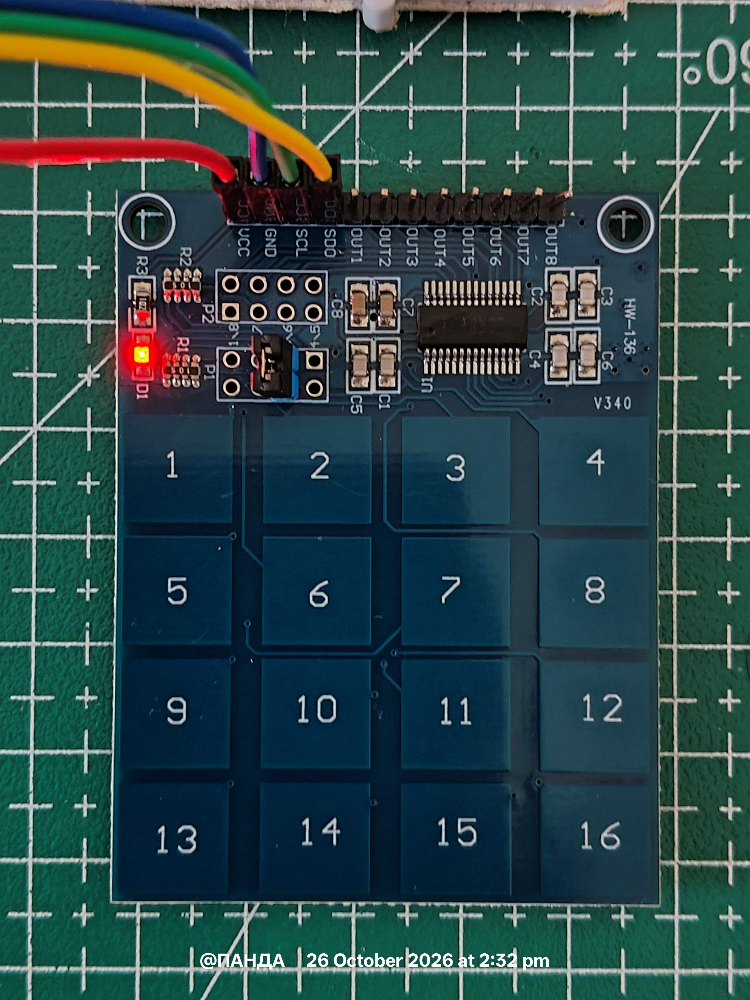
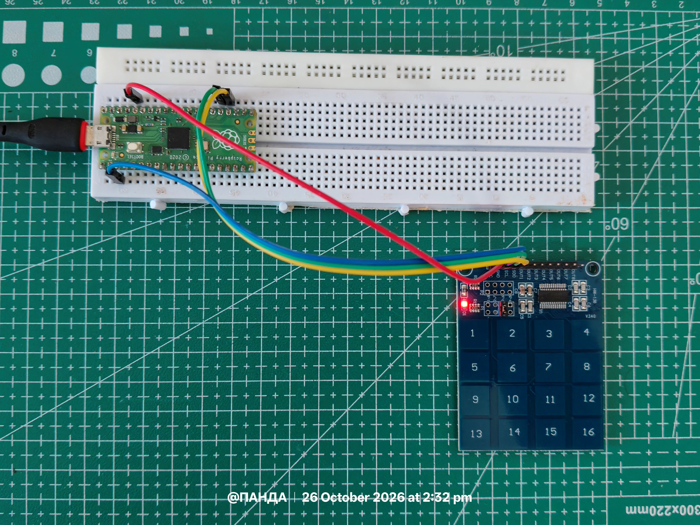
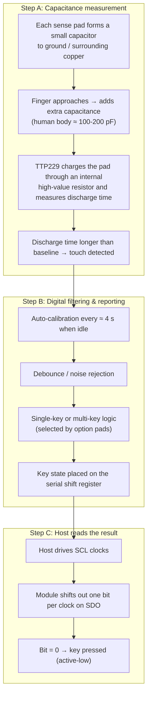
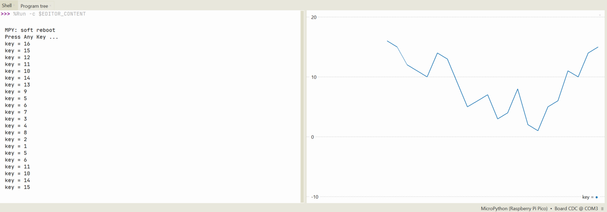
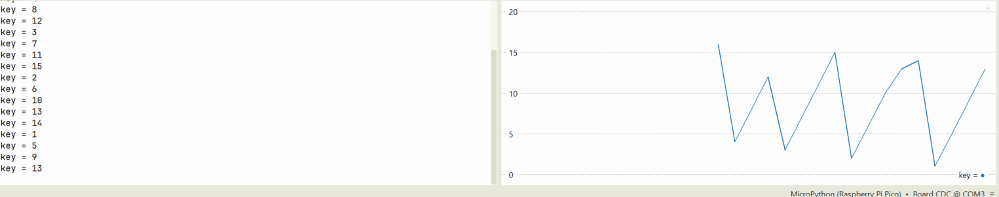

# HW-136 TTP229 Capacitive Touch Keypad

<p align="center">
 
</p>

## Interfacing the HW-136 / TTP229 16-Channel Digital Capacitive Switch Touch Sensor Module with Raspberry Pi Pico

The TTP229 (often sold as the **HW-136** module) is a capacitive touch sensor IC that detects the presence of a finger near one of its sense pads by measuring a tiny change in capacitance. It requires **no mechanical buttons**, no matrix scanning diodes, and only **two GPIO pins** when used in 16-key serial mode.

Unlike a classic membrane keypad, the module senses touch through glass, plastic, wood or acrylic (a few millimetres thick) and needs no force. It is ideal for modern front panels, PIN pads, menu navigation and any project where mechanical switches would wear out or look dated.

## Table of Contents

- [HW-136 TTP229 Capacitive Touch Keypad](#hw-136-ttp229-capacitive-touch-keypad)
 - [Interfacing the HW-136 / TTP229 16-Channel Digital Capacitive Switch Touch Sensor Module with Raspberry Pi Pico](#interfacing-the-hw-136--ttp229-16-channel-digital-capacitive-switch-touch-sensor-module-with-raspberry-pi-pico)
 - [Table of Contents](#table-of-contents)
 - [Hardware Wiring Context](#hardware-wiring-context)
 - [Operating Modes](#operating-modes)
 - [How Capacitive Touch Actually Works](#how-capacitive-touch-actually-works)
 - [2-Wire Serial Protocol (SCL + SDO)](#2-wire-serial-protocol-scl--sdo)
 - [Clock timing](#clock-timing)
- [Line-by-Line ExplanationFile: main.py](#line-by-line-explanationfile-mainpy)
 - [Imports](#imports)
 - [Pin setup](#pin-setup)
 - [Mode constant](#mode-constant)
 - [`_key_map` helper](#_key_map-helper)
 - [`key_read`: idle check](#key_read-idle-check)
 - [Data-valid wait](#data-valid-wait)
 - [Main scan loop](#main-scan-loop)
 - [Finishing the frame](#finishing-the-frame)
 - [Cleanup and return](#cleanup-and-return)
 - [`main`](#main)
 - [Outputs](#outputs)

## Hardware Wiring Context

| Module pin | Pico pin | Notes |
|------------|----------|-------|
| VCC | 3V3 | 2.4 - 5.5 V (3.3 V is ideal) |
| GND | GND | Common ground is mandatory |
| SCL | GP19 | Clock driven by the Pico (output) |
| SDO | GP18 | Serial data from the module (input, pull-up) |

The remaining pins (OUT1-OUT8) are only used in the 8-key parallel mode and are left unconnected in this project.

**Important:** For 16-key mode the solder jumper **TP2** (sometimes labelled P2 or KYSEL) on the module **must be shorted**. If the jumper is open the chip runs in 8-key mode and only the first eight pads are active.





## Operating Modes

| Mode | TP2 jumper | Active keys | Interface | Simultaneous keys |
|---------------|------------|-------------|--------------------|-------------------|
| 8-key | open | 1-8 | 8 independent OUT pins **or** 2-wire serial | Yes (multi-key) |
| 16-key | shorted | 1-16 | 2-wire serial only (SCL + SDO) | No (single key) |

This repository uses **16-key serial mode**.

## How Capacitive Touch Actually Works



Because the sensing is purely capacitive:
- It works through non-conductive materials (glass, acrylic, thin wood).
- It does not work through metal (the field is shorted).
- Sensitivity can be fine-tuned with a small external capacitor on the sensitivity pin (rarely needed on the HW-136 module). 


## 2-Wire Serial Protocol (SCL + SDO)

The HW-136 uses a two-wire serial interface consisting of SCL (clock input) and SDO (serial data output). This interface is **not I²C**: it does not use I²C addressing, acknowledgements or a bidirectional data line.

In 16-key mode, the host reads the key-state data by generating clock pulses on SCL and sampling the corresponding bits on SDO.

1. **Data-valid indication:** The device can provide a short data-valid (DV) pulse on SDO. The datasheet specifies a typical pulse width of approximately 93 µs.
2. **Clock generation:** The host generates the required clock pulses on SCL to read the key-state data.
3. **Bit order:** The serial data represents the states of keys TP0-TP15. Confirm the bit order against the datasheet timing diagram and verify the physical key mapping on the module.
4. **Data polarity:** The serial output can be configured for active-high or active-low operation. In the active-low configuration, a low data bit indicates a detected touch.
5. **Interface timeout:** If SCL experiences no transition for approximately 2 ms, the serial interface resets to its standby state.

The TTP229 also supports polling, so the host does not necessarily have to detect the DV pulse before every read. The precise clock timing and data interpretation must follow the configuration of the IC on the module.

In this project, the Raspberry Pi Pico implements the serial interface using two GPIO pins and MicroPython bit-banging.

### Clock timing

The driver generates SCL transitions using GPIO bit-banging in MicroPython. A 1 ms delay is inserted between transitions, so the nominal clock frequency is approximately 500 Hz, excluding software execution overhead.

The implementation has been tested on the Raspberry Pi Pico with the HW-136 TTP229 module, and all 16 keys were detected correctly during testing. This confirms functional operation with the tested hardware configuration; it does not, by itself, establish compliance with every datasheet timing specification.


# Line-by-Line ExplanationFile: main.py


 
### Imports
 
```python
from machine import Pin
from utime import sleep_ms, sleep_us
```
 
Imports GPIO control and millisecond/microsecond delays.
 
### Pin setup
 
```python
scl = Pin(19, Pin.OUT, value=0)
sdo = Pin(18, Pin.IN, Pin.PULL_UP)
```
 
- `scl` (GPIO 19) is the clock line you drive. It starts low.
- `sdo` (GPIO 18) is the data line from the chip. The internal pull-up is correct because the TTP229's output is open-drain.
### Mode constant
 
```python
KEY_MODE = 32 # 16-key mode; use 16 for 8-key mode
```
 
This is the number of clock **toggles**, not clock cycles. One full clock pulse is 2 toggles, so 32 toggles means 16 pulses, one per key. 8-key mode needs 16 toggles.
 
### `_key_map` helper
 
```python
def _key_map(data):
 key = 0
 for bit in data:
 if bit == 0:
 break
 key += 1
 return (key >> 1) + 1
```
 
Takes a list of bits and finds the position of the first `0` (active-low means pressed). It converts the toggle index to a key number (`>> 1` divides by 2, `+ 1` makes it 1-based).
 
> **Note:** this function is never called. `key_read` repeats the same logic inline, so it is dead code.
 
### `key_read`: idle check
 
```python
def key_read(mode=KEY_MODE):
 if sdo.value():
 scl.high()
 return 0
```
 
If SDO is high, no key is pressed. The function parks the clock high and returns `0`.
 
### Data-valid wait
 
```python
 sleep_us(103)
```
 
SDO went low, meaning "data valid". The TTP229 datasheet requires a wait of roughly 93 µs before clocking, so 103 µs matches it.
 
### Main scan loop
 
```python
 key = 0
 count = 0
 
 while count < mode:
 bit = sdo.value()
 
 if bit == 0:
 key = (count >> 1) + 1
 break
 
 scl.toggle()
 sleep_ms(1)
 count += 1
```
 
This is the core of the driver. It reads SDO, and if the bit is `0`, the key is `count / 2 + 1` and the loop stops. Otherwise it toggles the clock, waits 1 ms, and moves on. Each toggle takes 1 ms, so the clock runs at about 500 Hz, which is slow but valid.
 
### Finishing the frame
 
```python
 # Preserve the original clock-read cycle when a key is detected.
 if count < mode and key:
 scl.toggle()
 sleep_ms(1)
 count += 1
 
 while count < mode:
 scl.toggle()
 sleep_ms(1)
 count += 1
```
 
If the loop broke out early, the code still clocks out the rest of the frame. The chip expects a complete 16-clock frame, and skipping the remainder can leave it out of sync. The comment "Preserve the original clock-read cycle" suggests the code was refactored from an earlier version.
 
### Cleanup and return
 
```python
 scl.low()
 sleep_ms(2)
 return key
```
 
Leaves the clock low, waits 2 ms, and returns the key number (`0` if none).
 
### `main`
 
```python
def main():
 print("Press Any Key ...")
 
 while True:
 key = key_read()
 if key:
 print("key =", key)
 
 
if __name__ == "__main__":
 main()
```
 
A polling loop that prints each detected key. The `__main__` guard just runs it.


## Outputs 





## Practical Limitations

Although the TTP229 provides reliable capacitive touch detection for keypad applications, its operation has some practical limitations:

1. **Environmental sensitivity:** Moisture, condensation, conductive contaminants, and changes in the surrounding environment can affect capacitive sensing. These conditions may reduce sensitivity or cause unintended detections.

2. **Sensitivity depends on the physical design:** Electrode dimensions, PCB layout, nearby conductive objects, and the thickness and material of any protective overlay influence touch performance. Sensitivity adjustments may be necessary when changing the physical design.

3. **Metal shielding:** A grounded metal layer between the user's finger and the sensing electrode can significantly weaken or block the electric field, preventing normal touch detection. Metal enclosures therefore require careful electrode placement and design.

4. **Power-supply stability:** Supply-voltage fluctuations and electrical noise can affect sensing stability. Use a suitable power supply and appropriate decoupling, particularly in circuits containing motors, switching converters, or other noisy components.

5. **Power-on calibration:** The TTP229 requires an initial stabilization period after power-up. The datasheet specifies approximately 0.5 seconds during which normal touch detection is unavailable. Avoid touching the keypad during this period.

6. **Recalibration behaviour:** The controller can recalibrate when no keys have been detected for a specified idle period, approximately four seconds under the documented configuration. Environmental changes or objects remaining on a sensing pad can affect detection behaviour.

7. **Key detection and response time:** Capacitive sensing is not instantaneous. Detection latency depends on the controller's sampling configuration and the communication and polling strategy used by the host. It is suitable for ordinary keypad input but should not be treated as a precision timing or high-speed input device.

8. **Simultaneous key presses:** Single-key and multi-key detection depend on the TTP229's configuration. Do not assume that multiple simultaneous touches will be reported independently unless the selected configuration supports and has been tested for that behaviour.

9. **Module-specific configuration:** The HW-136 module's jumper and solder-pad settings determine its operating mode. The 8-key/16-key selection, output polarity, and other options must match the hardware configuration and the host driver's assumptions.

10. **Limited touch-position information:** The TTP229 reports discrete touch-key states rather than continuous coordinates or pressure. It cannot directly determine where a finger is positioned within a pad or how hard the pad is being pressed.

These limitations are typical considerations for capacitive touch controllers and do not imply a malfunction in the tested implementation. Actual performance depends on the controller configuration, module design, electrical environment, and application requirements.


## Applications

The TTP229 16-key capacitive touch controller can be used in a variety of embedded systems and interactive electronic projects:

- **Access Control Systems:** Build PIN-based entry systems for cabinets, lockers, and electronic door locks.
- **Home Automation:** Create touch-controlled interfaces for lights, fans, and other appliances.
- **Embedded User Interfaces:** Use the 16 touch pads as input controls for menus, configuration screens, and device settings.
- **DIY Security Systems:** Implement keypad input for arming, disarming, or configuring an alarm system.
- **Touch-Controlled Appliances:** Develop touch-operated control panels for suitable low-voltage electronic devices.
- **Robotics and Embedded Projects:** Use individual touch keys to trigger commands, change operating modes, or control robot functions.
- **Electronic Instrumentation:** Provide a compact input interface for test equipment, measurement instruments, and laboratory prototypes.
- **Interactive Displays:** Build touch-operated menus and selection interfaces for information displays and interactive installations.
- **Digital Games:** Use the keypad as a simple controller for quizzes, memory games, reaction tests, and other embedded games.
- **Custom Control Panels:** Design compact touch interfaces for DIY electronics projects where mechanical push-buttons are undesirable.

### Integration Possibilities

The keypad can be combined with a Raspberry Pi Pico, an OLED or TFT display, an RTC module, an RFID reader, or wireless communication hardware to build more complete embedded systems.

**Note:** The TTP229 is an input controller, not a complete security or appliance-control system. Applications involving locks, mains-powered appliances, or other safety-critical equipment require appropriate external control circuitry and independent safety measures.